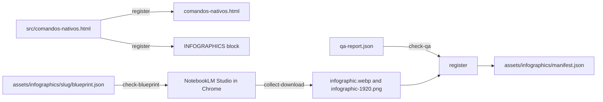
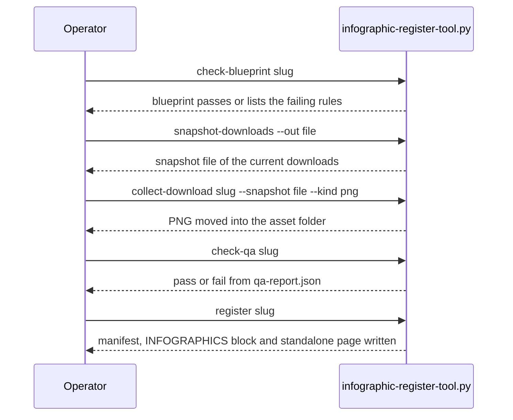

<div align="center">

# 📘 Claude Native Commands

[](README.md) [-green.svg)](README.pt-BR.md)

A Brazilian Portuguese guide to the native slash commands of Claude Code Desktop, with one infographic card per command.

[](CHANGELOG.md) [](LICENSE) [](.claude/skills/notebooklm-command-infographic-playbook/scripts)

[Installation](#-installation) · [Usage](#-usage) · [Changelog](CHANGELOG.md) · [Security](SECURITY.md)

</div>

## 📌 Status

Alpha. No version tag exists yet, and the content may change at any time.

## 💡 Why it exists

Claude Code Desktop offers slash commands that are hard to find and hard to tell apart. This page lists them in pt-BR, groups them by category and shows, for each command, what it does and when to use it. The page is generated from one hand-edited source file, so the guide and its standalone copy never drift apart.

It does not run Claude commands, does not replace the official documentation and does not publish anything by itself.

## 🎁 What it delivers

- `comandos-nativos.html`: a standalone page with the command guide, generated from `src/comandos-nativos.html`.
- `src/comandos-nativos.html`: the only hand-edited page file. Card data lives in the `COMMANDS`, `NEW_COMMANDS`, `LOTE7_COMMANDS`, `LOTE8_COMMANDS` and `LOTE9_COMMANDS` arrays.
- `assets/infographics/<slug>/`: per-command files (`blueprint.json`, `nota.md`, `roteiro.md`, `qa-report.json`) and the downloadable image formats for each card that has one.
- `assets/infographics/manifest.json`: the index of the registered infographics (`autocompact`, `btw`, `clear`, `code-review`, `compact`, `context`, `logout`, `loop`, `memory`, `model`, `recap`, `resume`, `review`, `rewind`, `status` at this commit).
- `.claude/skills/notebooklm-command-infographic-playbook/`: the project skill and the `infographic-register-tool.py` script that checks and registers each infographic, with 224 tests.

<!-- CATALOG:BEGIN -->
## 📚 Command catalog

The descriptions below are in Portuguese, as the guide is. The catalog has 82 commands; 14 already have a registered infographic (link "ver").

### Contexto e memória

| Command | What it does | Type | Infographic |
| ------- | --------- | ---- | ----------- |
| `/compact` | Resumir a conversa e liberar contexto | Comando embutido | [ver](assets/infographics/compact/infographic.webp) |
| `/context` | Quanto da janela de contexto já foi usado | Comando embutido | [ver](assets/infographics/context/infographic.webp) |
| `/recap` | Resumo de uma linha agora | Comando embutido | [ver](assets/infographics/recap/infographic.webp) |
| `/autocompact` | Quando a compactação automática entra | Comando embutido | [ver](assets/infographics/autocompact/infographic.webp) |
| `/clear` | Começar do zero na mesma pasta | Comando embutido | [ver](assets/infographics/clear/infographic.webp) |
| `/btw` | Pergunta rápida que não entra na conversa | Comando embutido | [ver](assets/infographics/btw/infographic.webp) |
| `/memory` | Editar CLAUDE.md e a memória automática | Comando embutido | [ver](assets/infographics/memory/infographic.webp) |
| `/rewind` | Voltar a conversa ou o código a um ponto anterior | Comando embutido | [ver](assets/infographics/rewind/infographic.webp) |
| `/resume` | Retomar uma conversa por ID, nome ou seletor | Comando embutido | em produção |

### Modelo e potência

| Command | What it does | Type | Infographic |
| ------- | --------- | ---- | ----------- |
| `/advisor` | Um revisor mais forte nos momentos-chave | Comando embutido | em produção |
| `/effort` | Nível de esforço do modelo | Comando embutido | em produção |
| `/model` | Trocar o modelo da sessão | Comando embutido | em produção |
| `/fast` | Modo rápido | Comando embutido | em produção |
| `/plan` | Entrar no modo plano, com ou sem tarefa | Comando embutido | em produção |
| `/fork` | Copiar a conversa para uma sessão em segundo plano | Comando embutido | em produção |

### Revisão de código

| Command | What it does | Type | Infographic |
| ------- | --------- | ---- | ----------- |
| `/code-review` | Caçar bugs no diff atual | Skill embutida | [ver](assets/infographics/code-review/infographic.webp) |
| `/simplify` | Limpar o código alterado | Skill embutida | em produção |
| `/security-review` | Revisão de segurança do branch | Comando embutido | em produção |
| `/ultrareview` | Revisão profunda de código em sandbox na nuvem | Comando embutido | em produção |
| `/diff` | Revisar as mudanças da árvore de trabalho | Comando embutido | em produção |
| `/copy` | Copiar a última resposta ou uma anterior | Comando embutido | em produção |
| `/review` | Nome antigo do /code-review | Alias | [ver](assets/infographics/review/infographic.webp) |
| `/verify` | Confirmar a mudança rodando o app de verdade | Skill embutida | em produção |

### Automação

| Command | What it does | Type | Infographic |
| ------- | --------- | ---- | ----------- |
| `/goal` | Trabalhar até a meta ser cumprida | Comando embutido | em produção |
| `/loop` | Repetir em intervalos | Skill embutida | [ver](assets/infographics/loop/infographic.webp) |
| `/run` | Abrir o app e ver a mudança funcionando | Skill embutida | em produção |
| `/batch` | Mudança grande em paralelo, um PR por parte | Skill embutida | em produção |
| `/tasks` | Ver e gerenciar o trabalho em segundo plano | Comando embutido | em produção |
| `/workflows` | Acompanhar workflows em execução e concluídos | Comando embutido | em produção |
| `/subtask` | Subagente com a conversa inteira | Comando embutido | em produção |
| `/deep-research` | Pesquisar na web e entregar relatório com fontes | Workflow embutido | em produção |
| `/agents` | Gerenciar subagentes (assistente removido) | Comando embutido | em produção |

### Diagnóstico e uso

| Command | What it does | Type | Infographic |
| ------- | --------- | ---- | ----------- |
| `/skill-doctor` | Skills carregadas que só gastam contexto | Comando embutido | em produção |
| `/usage` | Custo da sessão e uso do plano | Comando embutido | em produção |
| `/doctor` | Check-up da instalação | Skill embutida | em produção |
| `/insights` | Relatório das suas sessões | Comando embutido | em produção |
| `/debug` | Investigar um problema da sessão | Skill embutida | em produção |
| `/team-onboarding` | Guia para novos colegas, feito do seu uso | Comando embutido | em produção |
| `/usage-credits` | Créditos extras quando o limite do plano acaba | Comando embutido | em produção |
| `/heapdump` | Gerar snapshot de memória para diagnóstico | Comando embutido | em produção |
| `/feedback` | Enviar feedback sobre o Claude Code | Comando embutido | em produção |
| `/status` | Ver versão, modelo, conta e conectividade | Comando embutido | [ver](assets/infographics/status/infographic.webp) |
| `/stats` | Abrir o painel de uso direto na aba Stats | Comando embutido | em produção |
| `/cost` | Nome antigo do /usage | Alias | em produção |
| `/bug` | Nome antigo do /feedback | Alias | em produção |

### Extensões e conexões

| Command | What it does | Type | Infographic |
| ------- | --------- | ---- | ----------- |
| `/mcp` | Gerenciar servidores MCP | Comando embutido | em produção |
| `/list-agents` | Quem pode receber mensagem | Comando embutido | em produção |
| `/reload-skills` | Usar uma skill nova sem reabrir | Comando embutido | em produção |
| `/reload-plugins` | Ativar plugins sem abrir outra sessão | Comando embutido | em produção |
| `/skills` | Listar e filtrar as skills disponíveis | Comando embutido | em produção |
| `/artifact-capabilities` | Recursos que uma página publicada pode usar | Skill embutida | em produção |
| `/plugin` | Gerenciar plugins do Claude Code | Comando embutido | em produção |
| `/remote-control` | Deixar esta sessão disponível no claude.ai | Comando embutido | em produção |
| `/design-consent` | Conceder ao Claude acesso ao Claude Design | Comando embutido | em produção |
| `/design-revoke` | Retirar o acesso do Claude ao Claude Design | Comando embutido | em produção |

### Criação e referência

| Command | What it does | Type | Infographic |
| ------- | --------- | ---- | ----------- |
| `/claude-api` | Referência da API da Claude ao construir apps | Skill embutida | em produção |
| `/run-skill-generator` | Criar a skill que sabe rodar o app do projeto | Skill embutida | em produção |
| `/design-sync` | Enviar seu design system ao Claude Design | Skill embutida | em produção |
| `/dataviz` | Gráficos que seguem um só sistema visual | Skill embutida | em produção |
| `/artifact-diagramming` | Diagramas que mostram o mecanismo, não só o nome | Skill embutida | em produção |
| `/workflow-authoring` | Referência para escrever um script de workflow | Skill embutida | em produção |
| `/plugin-authoring` | Criar um mod: painel, barra, comando ou hook | Skill de plugin embutido | em produção |
| `/design` | Rascunhar telas e artes como pranchetas no Claude Design | Skill embutida | em produção |
| `/slides` | Criar uma apresentação a partir de um resumo | Skill embutida | em produção |
| `/whiteboard` | Criar um quadro Whiteboard como artefato | Skill embutida | em produção |

### Ajustes e permissões

| Command | What it does | Type | Infographic |
| ------- | --------- | ---- | ----------- |
| `/fewer-permission-prompts` | Menos pedidos de permissão | Skill embutida | em produção |
| `/init` | Criar o CLAUDE.md do projeto | Comando embutido | em produção |
| `/output-style` | Estilo das respostas | Comando embutido | em produção |
| `/auto-mode-setup` | Ensinar o modo auto sobre o seu ambiente | Comando embutido | em produção |
| `/color` | Cor da barra de prompt da sessão | Comando embutido | em produção |
| `/config` | Mudar uma configuração pelo nome | Comando embutido | em produção |
| `/update-config` | Mudar hooks, permissões e variáveis em palavras | Skill embutida | em produção |
| `/rename` | Dar um nome à conversa atual | Comando embutido | em produção |
| `/import` | Trazer a configuração de outro agente de código | Comando embutido | em produção |
| `/add-dir` | Dar acesso a mais uma pasta de trabalho | Comando embutido | em produção |
| `/logout` | Sair da sua conta Anthropic | Comando embutido | [ver](assets/infographics/logout/infographic.webp) |
| `/focus` | Alternar a visão só com prompt e resposta | Comando embutido | em produção |
| `/theme` | Trocar o tema de cores do Claude Code | Comando embutido | em produção |
| `/permissions` | Gerenciar regras de permissão das ferramentas | Comando embutido | em produção |
| `/sandbox` | Ligar ou desligar o modo sandbox | Comando embutido | em produção |
| `/login` | Entrar na sua conta Anthropic | Comando embutido | em produção |
| `/help` | Mostrar a ajuda e os comandos disponíveis | Comando embutido | em produção |


Catalog generated from the data of the `comandos-nativos.html` page, in page order.
<!-- CATALOG:END -->

## 🔬 How it works

The page is a static HTML file with one inline script. The infographic pipeline has three barriers: the blueprint is checked before the NotebookLM run, the download is collected into the asset folder, and the audit report is checked before the result is registered.





The image is made in NotebookLM Studio by hand in Chrome. No script calls NotebookLM.

## 📋 Prerequisites

| Platform | Status | Notes |
| -------- | ------ | ----- |
| Linux    | ✅     | Used for every test run in this repository. |
| macOS    | ⚠️     | Not verified. |
| Windows  | ⚠️     | Not verified. |

Python 3 runs the register tool and the tests. A Chromium-based browser is needed only for the Playwright template tests and for the manual NotebookLM step.

## 🚀 Installation

### 1️⃣ Clone the repository

```bash
git clone <repository-url> claude-native-commands
cd claude-native-commands
```

### 2️⃣ Open the guide

Open `comandos-nativos.html` in any browser. No build step is needed to read it.

### 3️⃣ Install the test dependencies (optional)

```bash
python3 -m pip install pytest ruff playwright
python3 -m playwright install chromium
```

## 🧹 Uninstall

Delete the clone directory. Playwright keeps its browsers outside the repository; remove them with `python3 -m playwright uninstall`, then `python3 -m pip uninstall playwright pytest ruff` if you installed them only for this project.

## 🧭 Usage

Run from the repository root. `S` is `.claude/skills/notebooklm-command-infographic-playbook/scripts`, and `<slug>` is a card id such as `compact`.

| Command | What it does |
| ------- | ------------ |
| `python3 S/infographic-register-tool.py --help` | Lists the subcommands. |
| `check-blueprint <slug>` | Barrier 1, before the NotebookLM run. |
| `labels <slug>` | Prints the lines for `roteiro.md`. |
| `snapshot-downloads --out <file>` | Records the current downloads before each download. |
| `collect-download <slug> --snapshot <file> --kind png` | Moves the new PNG into the asset folder. |
| `check-qa <slug>` | Barrier 3, after `qa-report.json` is written. |
| `register <slug>` | Writes the manifest item, the INFOGRAPHICS block and the standalone page. Needs `check-blueprint` and `check-qa` to pass. |

## 🧩 Configuration

| Name | Where | Effect |
| ---- | ----- | ------ |
| `INFOGRAPHIC_DOWNLOADS_DIR` | environment variable | Folder that `snapshot-downloads` and `collect-download` read when `--downloads` is not given. |
| `--root <dir>` | register tool flag | Project root. Without it, the tool searches upward from the working directory. |

## 🔒 Security and privacy

- The page loads two Google Fonts stylesheets (`fonts.googleapis.com`, `fonts.gstatic.com`) and links to `code.claude.com` documentation pages.
- The register tool makes no network calls. The Playwright template tests block network requests from the page under test.
- No API key, token or credential is stored in this repository. Report a vulnerability as described in [SECURITY.md](SECURITY.md).

## 🐞 Known issues

No known open issues as of 2026-11-23. Found one? Open an issue in this repository.

Limitations found in the code:

- Only 15 of the 82 cards have a registered infographic in `assets/infographics/manifest.json` (`autocompact`, `btw`, `clear`, `code-review`, `compact`, `context`, `logout`, `loop`, `memory`, `model`, `recap`, `resume`, `review`, `rewind`, `status`); the other 67 are being generated. The other folders under `assets/infographics/` have blueprints and notes, but no registered image.
- `work/infographic-contracts.md` (section 8) and the INFOGRAPHICS comment in the page still name `register_and_check.py`. The real script is `infographic-register-tool.py`.

## 🧪 Tests

| Category | Tests |
| -------- | ----- |
| blueprint rules (`test_blueprint_rules.py`) | 21 |
| register and check pipeline (`test_register_and_check.py`) | 107 |
| template layout, Playwright (`test_template_layout.py`) | 96 |
| **Total** | **224** |

Counts from `python3 -m pytest -o addopts= --collect-only -q -p no:cacheprovider tests`, run in `S`, grouped by test file, on 2026-11-23.

## 🔧 Development

```bash
cd .claude/skills/notebooklm-command-infographic-playbook/scripts
python3 -m pytest -q -p no:cacheprovider tests
ruff check .
```

Add `--basetemp=<dir>` to keep pytest's temporary directories out of `/tmp`.

## 📝 Changelog

Changes are listed in [CHANGELOG.md](CHANGELOG.md). The project follows [Semantic Versioning](https://semver.org/), and no release has been tagged yet.

## 🤝 Contributing

Issues are welcome. Outside pull requests are not accepted.

## 👤 Maintainer

The repository owner, through this repository's issues.

## 📄 License

All rights reserved. This is proprietary software with no SPDX license identifier. No license is granted to use, copy, modify or distribute it. See [LICENSE](LICENSE).
