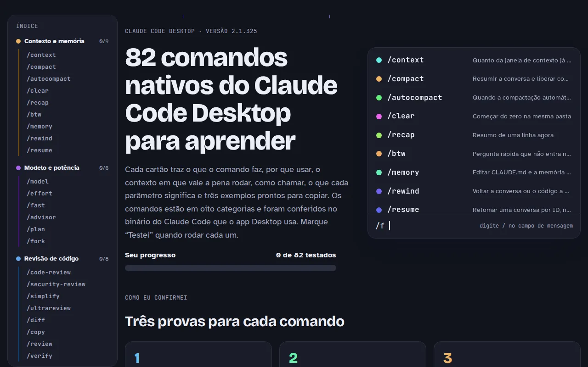
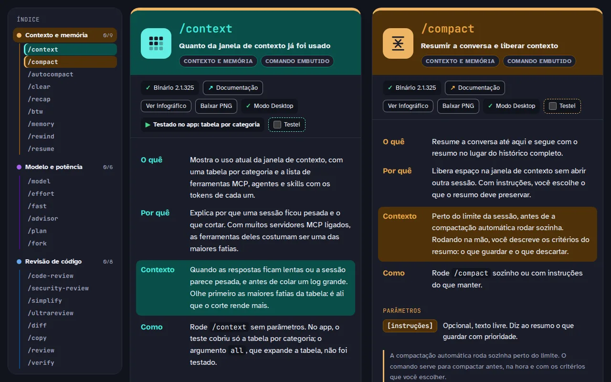
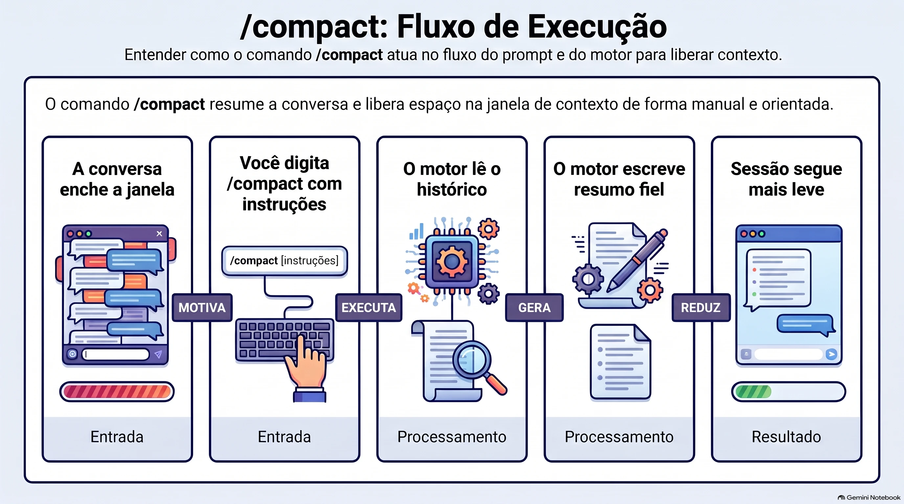
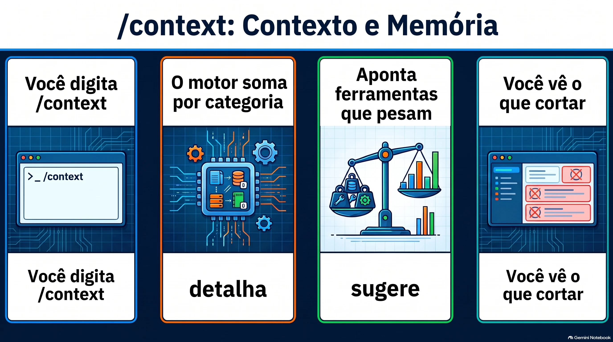
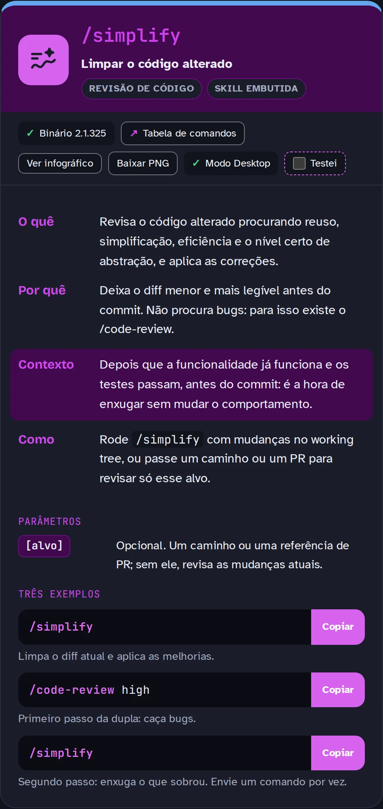
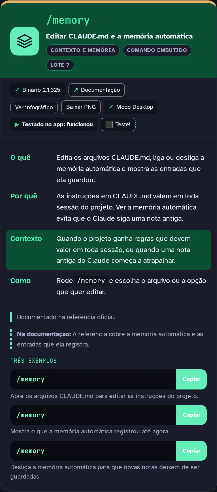
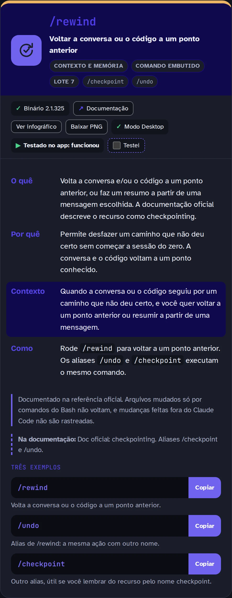
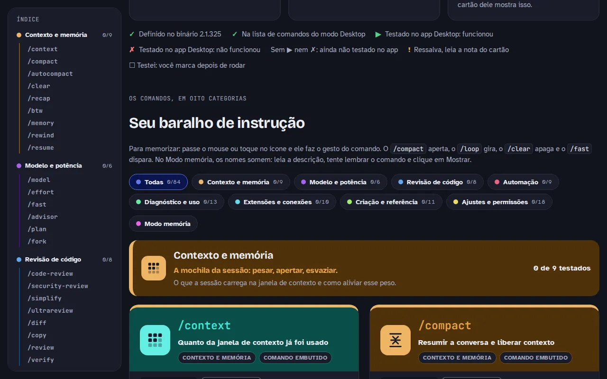
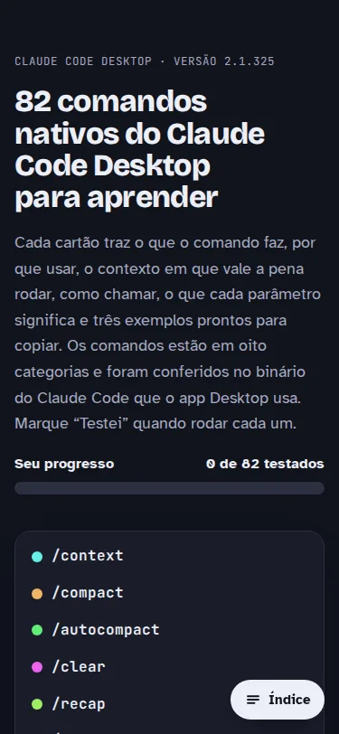

# 📘 Claude Native Commands

Aprenda os comandos nativos do Claude Code Desktop com um guia visual pronto para abrir no navegador.

Uma página HTML com um design atraente que ensina o que os comandos nativos do Claude Code Desktop podem fazer por você. Você testa cada comando e marca **Testei** (a marca fica só no seu navegador), navega pelas oito categorias e abre o infográfico de cada comando que tem um.

 

[Uso](#-uso) · [Changelog](CHANGELOG.md) · [Segurança](SECURITY.md)

Sumário

- [A página com cards abertos](#-a-página-com-cards-abertos)
- [Infográficos registrados](#-infográficos-registrados)
- [O que cada card traz](#-o-que-cada-card-traz)
- [Menu e filtros](#-menu-e-filtros)
- [Por que existe](#-por-que-existe)
- [O que entrega](#-o-que-entrega)
- [Catálogo dos comandos](#-catálogo-dos-comandos)
- [Uso](#-uso)
- [Segurança e privacidade](#-segurança-e-privacidade)

## 🃏 A página com cards abertos

Captura de 1280 px com os cards `/context` e `/compact` abertos.

## 🎨 Infográficos registrados

Quando um comando tem infográfico registrado, o card mostra os botões **Ver infográfico** e **Baixar PNG**. Três exemplos; clique em cada um para abrir o PNG completo:

  

O catálogo completo, com os 82 comandos e o link de cada infográfico, está em [Catálogo dos comandos](#-catálogo-dos-comandos).

## 🔎 O que cada card traz

Cada card reúne:

- **O quê** e **Por quê**: o que o comando faz e para que serve.
- **Contexto**: quando vale rodar o comando.
- **Como**: como chamar o comando, com ou sem parâmetros.
- **Parâmetros**: o que cada parâmetro faz, quando o comando aceita algum.
- **Três exemplos**: cada um com o botão **Copiar**.
- Uma nota com a ressalva do comando ou um detalhe da documentação oficial, quando houver.
- A linha de evidências: a versão do binário de referência (2.1.325), o link **Documentação**, o infográfico, o selo **Modo Desktop** (com aviso quando o comando está marcado como de terminal) e o resultado do teste no app Desktop: funcionou, não funcionou ou ainda não testado.
- A caixa **Testei**, que você marca depois de rodar o comando.

Três cards como aparecem na página; clique para ampliar:

  

## 🔍 Menu e filtros

O índice à esquerda lista as oito categorias, com quantos comandos você já testou em cada uma; clique num comando para ir até o card. Os filtros acima dos cards deixam só a categoria escolhida na tela. No **Modo memória**, os nomes somem: você lê a descrição, tenta lembrar o comando e clica em **Mostrar o comando**.

## 💡 Por que existe

Os comandos nativos do Claude Code Desktop, os que começam com `/`, são difíceis de achar e de diferenciar. Este guia:

- agrupa os comandos por categoria e mostra, para cada um, o que faz, por que usar, quando vale rodar e como chamar;
- deixa você marcar cada comando como testado, com o progresso guardado no navegador;
- mostra o infográfico de cada comando que já tem um registrado.

O guia não executa comandos do Claude Code e não substitui a documentação oficial.

## 🎁 O que entrega

- `comandos-nativos.html`: a página com os 82 cards, que abre sozinha no navegador.
- `assets/infographics/<slug>/`: as imagens de cada comando que já tem infográfico (`infographic.webp` e `infographic-1920.png`), que a página mostra e oferece para download.
- `.claude/skills/notebooklm-command-infographic-playbook/`: a skill que orienta a geração dos infográficos no NotebookLM.

<!-- CATALOG:BEGIN -->
## 📚 Catálogo dos comandos

O catálogo tem 82 comandos. Os 31 que já têm infográfico registrado trazem o link "ver"; nos outros, a coluna mostra "em preparo".

### Contexto e memória

| Comando | O que faz | Tipo | Infográfico |
| ------- | --------- | ---- | ----------- |
| `/compact` | Resumir a conversa e liberar contexto | Comando embutido | [ver](assets/infographics/compact/infographic.webp) |
| `/context` | Quanto da janela de contexto já foi usado | Comando embutido | [ver](assets/infographics/context/infographic.webp) |
| `/recap` | Resumo de uma linha agora | Comando embutido | [ver](assets/infographics/recap/infographic.webp) |
| `/autocompact` | Quando a compactação automática entra | Comando embutido | [ver](assets/infographics/autocompact/infographic.webp) |
| `/clear` | Começar do zero na mesma pasta | Comando embutido | [ver](assets/infographics/clear/infographic.webp) |
| `/btw` | Pergunta rápida que não entra na conversa | Comando embutido | [ver](assets/infographics/btw/infographic.webp) |
| `/memory` | Editar CLAUDE.md e a memória automática | Comando embutido | [ver](assets/infographics/memory/infographic.webp) |
| `/rewind` | Voltar a conversa ou o código a um ponto anterior | Comando embutido | [ver](assets/infographics/rewind/infographic.webp) |
| `/resume` | Retomar uma conversa por ID, nome ou seletor | Comando embutido | [ver](assets/infographics/resume/infographic.webp) |

### Modelo e potência

| Comando | O que faz | Tipo | Infográfico |
| ------- | --------- | ---- | ----------- |
| `/advisor` | Um revisor mais forte nos momentos-chave | Comando embutido | em preparo |
| `/effort` | Nível de esforço do modelo | Comando embutido | em preparo |
| `/model` | Trocar o modelo da sessão | Comando embutido | [ver](assets/infographics/model/infographic.webp) |
| `/fast` | Modo rápido | Comando embutido | em preparo |
| `/plan` | Entrar no modo plano, com ou sem tarefa | Comando embutido | em preparo |
| `/fork` | Copiar a conversa para uma sessão em segundo plano | Comando embutido | em preparo |

### Revisão de código

| Comando | O que faz | Tipo | Infográfico |
| ------- | --------- | ---- | ----------- |
| `/code-review` | Caçar bugs no diff atual | Skill embutida | [ver](assets/infographics/code-review/infographic.webp) |
| `/simplify` | Limpar o código alterado | Skill embutida | [ver](assets/infographics/simplify/infographic.webp) |
| `/security-review` | Revisão de segurança do branch | Comando embutido | [ver](assets/infographics/security-review/infographic.webp) |
| `/ultrareview` | Revisão profunda de código em sandbox na nuvem | Comando embutido | [ver](assets/infographics/ultrareview/infographic.webp) |
| `/diff` | Revisar as mudanças da árvore de trabalho | Comando embutido | [ver](assets/infographics/diff/infographic.webp) |
| `/copy` | Copiar a última resposta ou uma anterior | Comando embutido | [ver](assets/infographics/copy/infographic.webp) |
| `/review` | Nome antigo do /code-review | Alias | [ver](assets/infographics/review/infographic.webp) |
| `/verify` | Confirmar a mudança rodando o app de verdade | Skill embutida | em preparo |

### Automação

| Comando | O que faz | Tipo | Infográfico |
| ------- | --------- | ---- | ----------- |
| `/goal` | Trabalhar até a meta ser cumprida | Comando embutido | em preparo |
| `/loop` | Repetir em intervalos | Skill embutida | [ver](assets/infographics/loop/infographic.webp) |
| `/run` | Abrir o app e ver a mudança funcionando | Skill embutida | em preparo |
| `/batch` | Mudança grande em paralelo, um PR por parte | Skill embutida | em preparo |
| `/tasks` | Ver e gerenciar o trabalho em segundo plano | Comando embutido | [ver](assets/infographics/tasks/infographic.webp) |
| `/workflows` | Acompanhar workflows em execução e concluídos | Comando embutido | em preparo |
| `/subtask` | Subagente com a conversa inteira | Comando embutido | [ver](assets/infographics/subtask/infographic.webp) |
| `/deep-research` | Pesquisar na web e entregar relatório com fontes | Workflow embutido | [ver](assets/infographics/deep-research/infographic.webp) |
| `/agents` | Gerenciar subagentes (assistente removido) | Comando embutido | em preparo |

### Diagnóstico e uso

| Comando | O que faz | Tipo | Infográfico |
| ------- | --------- | ---- | ----------- |
| `/skill-doctor` | Skills carregadas que só gastam contexto | Comando embutido | em preparo |
| `/usage` | Custo da sessão e uso do plano | Comando embutido | [ver](assets/infographics/usage/infographic.webp) |
| `/doctor` | Check-up da instalação | Skill embutida | [ver](assets/infographics/doctor/infographic.webp) |
| `/insights` | Relatório das suas sessões | Comando embutido | em preparo |
| `/debug` | Investigar um problema da sessão | Skill embutida | [ver](assets/infographics/debug/infographic.webp) |
| `/team-onboarding` | Guia para novos colegas, feito do seu uso | Comando embutido | [ver](assets/infographics/team-onboarding/infographic.webp) |
| `/usage-credits` | Créditos extras quando o limite do plano acaba | Comando embutido | [ver](assets/infographics/usage-credits/infographic.webp) |
| `/heapdump` | Gerar snapshot de memória para diagnóstico | Comando embutido | [ver](assets/infographics/heapdump/infographic.webp) |
| `/feedback` | Enviar feedback sobre o Claude Code | Comando embutido | em preparo |
| `/status` | Ver versão, modelo, conta e conectividade | Comando embutido | [ver](assets/infographics/status/infographic.webp) |
| `/stats` | Abrir o painel de uso direto na aba Stats | Comando embutido | [ver](assets/infographics/stats/infographic.webp) |
| `/cost` | Nome antigo do /usage | Alias | em preparo |
| `/bug` | Nome antigo do /feedback | Alias | em preparo |

### Extensões e conexões

| Comando | O que faz | Tipo | Infográfico |
| ------- | --------- | ---- | ----------- |
| `/mcp` | Gerenciar servidores MCP | Comando embutido | em preparo |
| `/list-agents` | Quem pode receber mensagem | Comando embutido | em preparo |
| `/reload-skills` | Usar uma skill nova sem reabrir | Comando embutido | em preparo |
| `/reload-plugins` | Ativar plugins sem abrir outra sessão | Comando embutido | em preparo |
| `/skills` | Listar e filtrar as skills disponíveis | Comando embutido | [ver](assets/infographics/skills/infographic.webp) |
| `/artifact-capabilities` | Recursos que uma página publicada pode usar | Skill embutida | em preparo |
| `/plugin` | Gerenciar plugins do Claude Code | Comando embutido | em preparo |
| `/remote-control` | Deixar esta sessão disponível no claude.ai | Comando embutido | em preparo |
| `/design-consent` | Conceder ao Claude acesso ao Claude Design | Comando embutido | em preparo |
| `/design-revoke` | Retirar o acesso do Claude ao Claude Design | Comando embutido | em preparo |

### Criação e referência

| Comando | O que faz | Tipo | Infográfico |
| ------- | --------- | ---- | ----------- |
| `/claude-api` | Referência da API da Claude ao construir apps | Skill embutida | em preparo |
| `/run-skill-generator` | Criar a skill que sabe rodar o app do projeto | Skill embutida | em preparo |
| `/design-sync` | Enviar seu design system ao Claude Design | Skill embutida | em preparo |
| `/dataviz` | Gráficos que seguem um só sistema visual | Skill embutida | em preparo |
| `/artifact-diagramming` | Diagramas que mostram o mecanismo, não só o nome | Skill embutida | em preparo |
| `/workflow-authoring` | Referência para escrever um script de workflow | Skill embutida | em preparo |
| `/plugin-authoring` | Criar um mod: painel, barra, comando ou hook | Skill de plugin embutido | em preparo |
| `/design` | Rascunhar telas e artes como pranchetas no Claude Design | Skill embutida | em preparo |
| `/slides` | Criar uma apresentação a partir de um resumo | Skill embutida | em preparo |
| `/whiteboard` | Criar um quadro Whiteboard como artefato | Skill embutida | em preparo |

### Ajustes e permissões

| Comando | O que faz | Tipo | Infográfico |
| ------- | --------- | ---- | ----------- |
| `/fewer-permission-prompts` | Menos pedidos de permissão | Skill embutida | em preparo |
| `/init` | Criar o CLAUDE.md do projeto | Comando embutido | em preparo |
| `/output-style` | Estilo das respostas | Comando embutido | em preparo |
| `/auto-mode-setup` | Ensinar o modo auto sobre o seu ambiente | Comando embutido | em preparo |
| `/color` | Cor da barra de prompt da sessão | Comando embutido | em preparo |
| `/config` | Mudar uma configuração pelo nome | Comando embutido | em preparo |
| `/update-config` | Mudar hooks, permissões e variáveis em palavras | Skill embutida | em preparo |
| `/rename` | Dar um nome à conversa atual | Comando embutido | em preparo |
| `/import` | Trazer a configuração de outro agente de código | Comando embutido | em preparo |
| `/add-dir` | Dar acesso a mais uma pasta de trabalho | Comando embutido | em preparo |
| `/logout` | Sair da sua conta Anthropic | Comando embutido | [ver](assets/infographics/logout/infographic.webp) |
| `/focus` | Alternar a visão só com prompt e resposta | Comando embutido | em preparo |
| `/theme` | Trocar o tema de cores do Claude Code | Comando embutido | em preparo |
| `/permissions` | Gerenciar regras de permissão das ferramentas | Comando embutido | em preparo |
| `/sandbox` | Ligar ou desligar o modo sandbox | Comando embutido | em preparo |
| `/login` | Entrar na sua conta Anthropic | Comando embutido | em preparo |
| `/help` | Mostrar a ajuda e os comandos disponíveis | Comando embutido | em preparo |

Catálogo gerado a partir dos dados da página `comandos-nativos.html`, na ordem da página.
<!-- CATALOG:END -->

## 🧭 Uso

O `comandos-nativos.html` usa a pasta `assets/infographics/`, com os infográficos, que fica ao lado dele e deve ser baixada junto. A página foi feita para depender do mínimo possível e abre direto no navegador.

## 🔒 Segurança e privacidade

- A página carrega as fontes do Google Fonts (`fonts.googleapis.com`, `fonts.gstatic.com`) e tem links para páginas de documentação em `code.claude.com`.
- As marcações da caixa **Testei** ficam no armazenamento local do navegador (`localStorage`); a página não as envia a nenhum servidor.
- Nenhuma chave de API, token ou credencial é guardada neste repositório.
