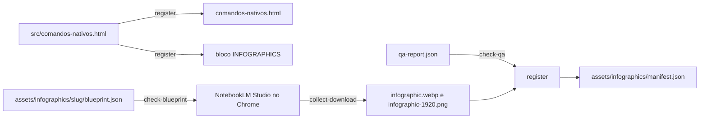
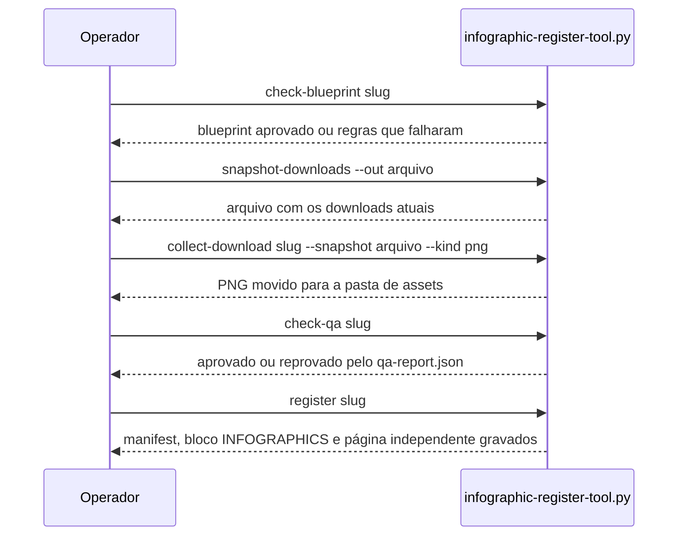

<div align="center">

# 📘 Claude Native Commands

[](README.md) [-green.svg)](README.pt-BR.md)

Um guia em português do Brasil sobre os comandos nativos (barra) do Claude Code Desktop, com um card de infográfico por comando.

[](CHANGELOG.md) [](LICENSE) [](.claude/skills/notebooklm-command-infographic-playbook/scripts)

[Instalação](#-instalação) · [Uso](#-uso) · [Changelog](CHANGELOG.md) · [Segurança](SECURITY.md)

</div>

## 📌 Status

Alfa. Ainda não há tag de versão, e o conteúdo pode mudar a qualquer momento.

## 💡 Por que existe

Os comandos de barra do Claude Code Desktop são difíceis de achar e de diferenciar. Esta página lista-os em pt-BR, agrupa por categoria e mostra, para cada comando, o que ele faz e quando usar. A página é gerada a partir de um único arquivo-fonte editado à mão, então o guia e a cópia independente nunca divergem.

Ela não executa comandos do Claude, não substitui a documentação oficial e não publica nada sozinha.

## 🎁 O que entrega

- `comandos-nativos.html`: uma página independente com o guia dos comandos, gerada a partir de `src/comandos-nativos.html`.
- `src/comandos-nativos.html`: o único arquivo de página editado à mão. Os dados dos cards ficam nos arrays `COMMANDS`, `NEW_COMMANDS`, `LOTE7_COMMANDS`, `LOTE8_COMMANDS` e `LOTE9_COMMANDS`.
- `assets/infographics/<slug>/`: arquivos por comando (`blueprint.json`, `nota.md`, `roteiro.md`, `qa-report.json`) e os formatos de imagem para download de cada card que tem imagem.
- `assets/infographics/manifest.json`: o índice dos infográficos registrados (`autocompact`, `btw`, `clear`, `code-review`, `compact`, `context`, `logout`, `loop`, `memory`, `model`, `recap`, `review`, `rewind`, `status` neste commit).
- `.claude/skills/notebooklm-command-infographic-playbook/`: a skill do projeto e o script `infographic-register-tool.py`, que verifica e registra cada infográfico, com 224 testes.

<!-- CATALOG:BEGIN -->
## 📚 Catálogo dos comandos

O catálogo tem 82 comandos; 14 já têm infográfico registrado (link "ver").

### Contexto e memória

| Comando | O que faz | Tipo | Infográfico |
| ------- | --------- | ---- | ----------- |
| `/compact` | Resumir a conversa e liberar contexto | Comando embutido | [ver](assets/infographics/compact/infographic.webp) |
| `/context` | Quanto da janela de contexto já foi usado | Comando embutido | [ver](assets/infographics/context/infographic.webp) |
| `/recap` | Resumo de uma linha agora | Comando embutido | [ver](assets/infographics/recap/infographic.webp) |
| `/autocompact` | Quando a compactação automática entra | Comando embutido | [ver](assets/infographics/autocompact/infographic.webp) |
| `/clear` | Começar do zero na mesma pasta | Comando embutido | [ver](assets/infographics/clear/infographic.webp) |
| `/btw` | Pergunta rápida que não entra na conversa | Comando embutido | [ver](assets/infographics/btw/infographic.webp) |
| `/memory` | Editar CLAUDE.md e a memória automática | Comando embutido | [ver](assets/infographics/memory/infographic.webp) |
| `/rewind` | Voltar a conversa ou o código a um ponto anterior | Comando embutido | [ver](assets/infographics/rewind/infographic.webp) |
| `/resume` | Retomar uma conversa por ID, nome ou seletor | Comando embutido | em produção |

### Modelo e potência

| Comando | O que faz | Tipo | Infográfico |
| ------- | --------- | ---- | ----------- |
| `/advisor` | Um revisor mais forte nos momentos-chave | Comando embutido | em produção |
| `/effort` | Nível de esforço do modelo | Comando embutido | em produção |
| `/model` | Trocar o modelo da sessão | Comando embutido | em produção |
| `/fast` | Modo rápido | Comando embutido | em produção |
| `/plan` | Entrar no modo plano, com ou sem tarefa | Comando embutido | em produção |
| `/fork` | Copiar a conversa para uma sessão em segundo plano | Comando embutido | em produção |

### Revisão de código

| Comando | O que faz | Tipo | Infográfico |
| ------- | --------- | ---- | ----------- |
| `/code-review` | Caçar bugs no diff atual | Skill embutida | [ver](assets/infographics/code-review/infographic.webp) |
| `/simplify` | Limpar o código alterado | Skill embutida | em produção |
| `/security-review` | Revisão de segurança do branch | Comando embutido | em produção |
| `/ultrareview` | Revisão profunda de código em sandbox na nuvem | Comando embutido | em produção |
| `/diff` | Revisar as mudanças da árvore de trabalho | Comando embutido | em produção |
| `/copy` | Copiar a última resposta ou uma anterior | Comando embutido | em produção |
| `/review` | Nome antigo do /code-review | Alias | [ver](assets/infographics/review/infographic.webp) |
| `/verify` | Confirmar a mudança rodando o app de verdade | Skill embutida | em produção |

### Automação

| Comando | O que faz | Tipo | Infográfico |
| ------- | --------- | ---- | ----------- |
| `/goal` | Trabalhar até a meta ser cumprida | Comando embutido | em produção |
| `/loop` | Repetir em intervalos | Skill embutida | [ver](assets/infographics/loop/infographic.webp) |
| `/run` | Abrir o app e ver a mudança funcionando | Skill embutida | em produção |
| `/batch` | Mudança grande em paralelo, um PR por parte | Skill embutida | em produção |
| `/tasks` | Ver e gerenciar o trabalho em segundo plano | Comando embutido | em produção |
| `/workflows` | Acompanhar workflows em execução e concluídos | Comando embutido | em produção |
| `/subtask` | Subagente com a conversa inteira | Comando embutido | em produção |
| `/deep-research` | Pesquisar na web e entregar relatório com fontes | Workflow embutido | em produção |
| `/agents` | Gerenciar subagentes (assistente removido) | Comando embutido | em produção |

### Diagnóstico e uso

| Comando | O que faz | Tipo | Infográfico |
| ------- | --------- | ---- | ----------- |
| `/skill-doctor` | Skills carregadas que só gastam contexto | Comando embutido | em produção |
| `/usage` | Custo da sessão e uso do plano | Comando embutido | em produção |
| `/doctor` | Check-up da instalação | Skill embutida | em produção |
| `/insights` | Relatório das suas sessões | Comando embutido | em produção |
| `/debug` | Investigar um problema da sessão | Skill embutida | em produção |
| `/team-onboarding` | Guia para novos colegas, feito do seu uso | Comando embutido | em produção |
| `/usage-credits` | Créditos extras quando o limite do plano acaba | Comando embutido | em produção |
| `/heapdump` | Gerar snapshot de memória para diagnóstico | Comando embutido | em produção |
| `/feedback` | Enviar feedback sobre o Claude Code | Comando embutido | em produção |
| `/status` | Ver versão, modelo, conta e conectividade | Comando embutido | [ver](assets/infographics/status/infographic.webp) |
| `/stats` | Abrir o painel de uso direto na aba Stats | Comando embutido | em produção |
| `/cost` | Nome antigo do /usage | Alias | em produção |
| `/bug` | Nome antigo do /feedback | Alias | em produção |

### Extensões e conexões

| Comando | O que faz | Tipo | Infográfico |
| ------- | --------- | ---- | ----------- |
| `/mcp` | Gerenciar servidores MCP | Comando embutido | em produção |
| `/list-agents` | Quem pode receber mensagem | Comando embutido | em produção |
| `/reload-skills` | Usar uma skill nova sem reabrir | Comando embutido | em produção |
| `/reload-plugins` | Ativar plugins sem abrir outra sessão | Comando embutido | em produção |
| `/skills` | Listar e filtrar as skills disponíveis | Comando embutido | em produção |
| `/artifact-capabilities` | Recursos que uma página publicada pode usar | Skill embutida | em produção |
| `/plugin` | Gerenciar plugins do Claude Code | Comando embutido | em produção |
| `/remote-control` | Deixar esta sessão disponível no claude.ai | Comando embutido | em produção |
| `/design-consent` | Conceder ao Claude acesso ao Claude Design | Comando embutido | em produção |
| `/design-revoke` | Retirar o acesso do Claude ao Claude Design | Comando embutido | em produção |

### Criação e referência

| Comando | O que faz | Tipo | Infográfico |
| ------- | --------- | ---- | ----------- |
| `/claude-api` | Referência da API da Claude ao construir apps | Skill embutida | em produção |
| `/run-skill-generator` | Criar a skill que sabe rodar o app do projeto | Skill embutida | em produção |
| `/design-sync` | Enviar seu design system ao Claude Design | Skill embutida | em produção |
| `/dataviz` | Gráficos que seguem um só sistema visual | Skill embutida | em produção |
| `/artifact-diagramming` | Diagramas que mostram o mecanismo, não só o nome | Skill embutida | em produção |
| `/workflow-authoring` | Referência para escrever um script de workflow | Skill embutida | em produção |
| `/plugin-authoring` | Criar um mod: painel, barra, comando ou hook | Skill de plugin embutido | em produção |
| `/design` | Rascunhar telas e artes como pranchetas no Claude Design | Skill embutida | em produção |
| `/slides` | Criar uma apresentação a partir de um resumo | Skill embutida | em produção |
| `/whiteboard` | Criar um quadro Whiteboard como artefato | Skill embutida | em produção |

### Ajustes e permissões

| Comando | O que faz | Tipo | Infográfico |
| ------- | --------- | ---- | ----------- |
| `/fewer-permission-prompts` | Menos pedidos de permissão | Skill embutida | em produção |
| `/init` | Criar o CLAUDE.md do projeto | Comando embutido | em produção |
| `/output-style` | Estilo das respostas | Comando embutido | em produção |
| `/auto-mode-setup` | Ensinar o modo auto sobre o seu ambiente | Comando embutido | em produção |
| `/color` | Cor da barra de prompt da sessão | Comando embutido | em produção |
| `/config` | Mudar uma configuração pelo nome | Comando embutido | em produção |
| `/update-config` | Mudar hooks, permissões e variáveis em palavras | Skill embutida | em produção |
| `/rename` | Dar um nome à conversa atual | Comando embutido | em produção |
| `/import` | Trazer a configuração de outro agente de código | Comando embutido | em produção |
| `/add-dir` | Dar acesso a mais uma pasta de trabalho | Comando embutido | em produção |
| `/logout` | Sair da sua conta Anthropic | Comando embutido | [ver](assets/infographics/logout/infographic.webp) |
| `/focus` | Alternar a visão só com prompt e resposta | Comando embutido | em produção |
| `/theme` | Trocar o tema de cores do Claude Code | Comando embutido | em produção |
| `/permissions` | Gerenciar regras de permissão das ferramentas | Comando embutido | em produção |
| `/sandbox` | Ligar ou desligar o modo sandbox | Comando embutido | em produção |
| `/login` | Entrar na sua conta Anthropic | Comando embutido | em produção |
| `/help` | Mostrar a ajuda e os comandos disponíveis | Comando embutido | em produção |


Catálogo gerado a partir dos dados da página `comandos-nativos.html`, na ordem da página.
<!-- CATALOG:END -->

## 🔬 Como funciona

A página é um arquivo HTML estático com um script inline. O pipeline de infográficos tem três barreiras: o blueprint é verificado antes da execução no NotebookLM, o download é coletado para a pasta de assets e o relatório de auditoria é verificado antes do registro do resultado.





A imagem é feita à mão no NotebookLM Studio, no Chrome. Nenhum script chama o NotebookLM.

## 📋 Pré-requisitos

| Plataforma | Status | Observações |
| ---------- | ------ | ----------- |
| Linux      | ✅     | Usado em todas as execuções de teste deste repositório. |
| macOS      | ⚠️     | Não verificado. |
| Windows    | ⚠️     | Não verificado. |

Python 3 executa a ferramenta de registro e os testes. Um navegador baseado em Chromium é necessário só para os testes de layout do template (Playwright) e para a etapa manual no NotebookLM.

## 🚀 Instalação

### 1️⃣ Clone o repositório

```bash
git clone <url-do-repositorio> claude-native-commands
cd claude-native-commands
```

### 2️⃣ Abra o guia

Abra `comandos-nativos.html` em qualquer navegador. Não há etapa de build para ler a página.

### 3️⃣ Instale as dependências de teste (opcional)

```bash
python3 -m pip install pytest ruff playwright
python3 -m playwright install chromium
```

## 🧹 Desinstalação

Apague a pasta do clone. O Playwright guarda os navegadores fora do repositório; remova-os com `python3 -m playwright uninstall` e, se instalou os pacotes só para este projeto, rode `python3 -m pip uninstall playwright pytest ruff`.

## 🧭 Uso

Execute a partir da raiz do repositório. `S` é `.claude/skills/notebooklm-command-infographic-playbook/scripts`, e `<slug>` é um id de card, como `compact`.

| Comando | O que faz |
| ------- | --------- |
| `python3 S/infographic-register-tool.py --help` | Lista os subcomandos. |
| `check-blueprint <slug>` | Barreira 1, antes da execução no NotebookLM. |
| `labels <slug>` | Imprime as linhas para o `roteiro.md`. |
| `snapshot-downloads --out <arquivo>` | Registra os downloads atuais antes de cada download. |
| `collect-download <slug> --snapshot <arquivo> --kind png` | Move o PNG novo para a pasta de assets. |
| `check-qa <slug>` | Barreira 3, depois que o `qa-report.json` é gravado. |
| `register <slug>` | Grava o item do manifest, o bloco INFOGRAPHICS e a página independente. Exige `check-blueprint` e `check-qa` aprovados. |

## 🧩 Configuração

| Nome | Onde | Efeito |
| ---- | ---- | ------ |
| `INFOGRAPHIC_DOWNLOADS_DIR` | variável de ambiente | Pasta que `snapshot-downloads` e `collect-download` leem quando `--downloads` não é informado. |
| `--root <dir>` | opção da ferramenta de registro | Raiz do projeto. Sem ela, a ferramenta procura para cima a partir do diretório atual. |

## 🔒 Segurança e privacidade

- A página carrega duas folhas de estilo do Google Fonts (`fonts.googleapis.com`, `fonts.gstatic.com`) e tem links para páginas de documentação em `code.claude.com`.
- A ferramenta de registro não faz chamadas de rede. Os testes de layout do template (Playwright) bloqueiam requisições de rede da página testada.
- Nenhuma chave de API, token ou credencial é guardada neste repositório. Para reportar uma vulnerabilidade, siga o [SECURITY.md](SECURITY.md).

## 🐞 Problemas conhecidos

Nenhum problema aberto conhecido em 2026-11-23. Encontrou um? Abra uma issue neste repositório.

Limitações encontradas no código:

- Só 14 dos 82 cards têm infográfico registrado em `assets/infographics/manifest.json` (`autocompact`, `btw`, `clear`, `code-review`, `compact`, `context`, `logout`, `loop`, `memory`, `model`, `recap`, `review`, `rewind`, `status`); os outros 68 estão sendo gerados. As outras pastas em `assets/infographics/` têm blueprint e notas, mas ainda não têm imagem registrada.
- `work/infographic-contracts.md` (seção 8) e o comentário INFOGRAPHICS da página ainda citam `register_and_check.py`. O script real é `infographic-register-tool.py`.

## 🧪 Testes

| Categoria | Testes |
| --------- | ------ |
| regras do blueprint (`test_blueprint_rules.py`) | 21 |
| pipeline de registro e verificação (`test_register_and_check.py`) | 107 |
| layout do template, Playwright (`test_template_layout.py`) | 96 |
| **Total** | **224** |

Contagens de `python3 -m pytest -o addopts= --collect-only -q -p no:cacheprovider tests`, executado em `S`, agrupadas por arquivo de teste, em 2026-11-23.

## 🔧 Desenvolvimento

```bash
cd .claude/skills/notebooklm-command-infographic-playbook/scripts
python3 -m pytest -q -p no:cacheprovider tests
ruff check .
```

Adicione `--basetemp=<dir>` para manter os diretórios temporários do pytest fora de `/tmp`.

## 📝 Changelog

As mudanças estão em [CHANGELOG.md](CHANGELOG.md). O projeto segue o [Versionamento Semântico](https://semver.org/lang/pt-BR/), e nenhuma versão foi marcada ainda.

## 🤝 Contribuições

Issues são bem-vindas. Pull requests de fora não são aceitos.

## 👤 Mantenedor

O dono do repositório, pelas issues deste repositório.

## 📄 Licença

Todos os direitos reservados. Software proprietário, sem identificador SPDX de licença. Nenhuma licença é concedida para usar, copiar, modificar ou distribuir. Veja [LICENSE](LICENSE).
